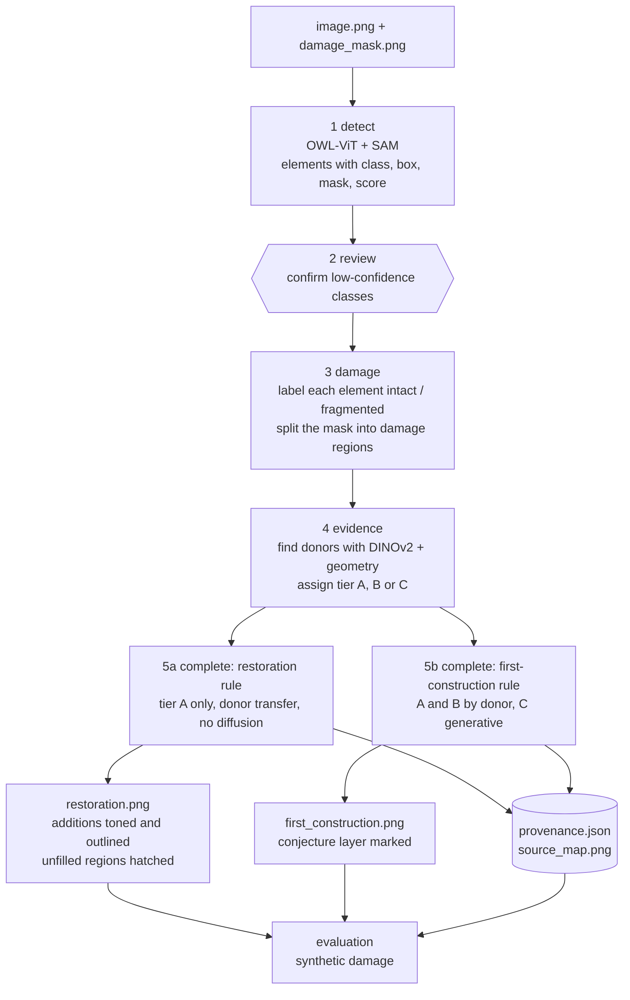

# ImageToRender — Architecture (this stage)

> **Türkçe özet.** Bu belge yalnızca bu aşamanın mimarisini tanımlar: tek fotoğraftan eleman tanıma, hasar
> tespiti, yapının kendi sağlam elemanlarından kanıt (donör) bulma ve iki çıktı (restorasyon görünümü,
> ilk inşa görünümü) ile kaynak kaydı. Tek giriş noktası, altı modül, bir ayar dosyası ve `archive/`
> öneriyor. Kemer/pilaster'a özel eski Stage 3 zinciri arşive gidiyor. Uygulama adımları `docs/TASKS.md`,
> eski denemelerin dökümü `docs/EXPERIMENTS.md` dosyasındadır.

Read `docs/EXPERIMENTS.md` first for what exists today. This document describes what to build.

---

## 1. Scope of this stage

**Input.** One photograph of a damaged historical building and a damage mask.

**Output.**

1. An inventory of architectural elements (window, door, arch, pilaster, column, cornice or moulding,
   eave, jamb, console, parapet, roof, base).
2. A **restoration view**: only regions with evidence in the building itself are completed; additions
   stay distinguishable; regions without evidence are left untouched and marked.
3. A **first-construction view**: the plausible state when built; regions without evidence may be filled
   generatively, and are marked as conjecture.
4. A **provenance record** for every completed region: which intact element it came from and with what
   confidence.

**Working principle.** Historical facades repeat and mirror. An intact element is the evidence for its
damaged counterpart. Nothing is learned from other buildings in this stage.

**Out of scope, but the design must not block them.** Learned models, multi-image 3D, more detailed
inference methods. §8 lists the seams left for them.

**Fixed environment.** Windows, RTX 2060 6 GB, conda env `ImageToRender_GPU`, Python 3.10, torch
2.4.0+cu121, xformers 0.0.27.post2, diffusers 0.20.2, transformers 4.33.2, huggingface-hub 0.16.4,
accelerate 0.22.0, numpy 1.26.4, opencv-python 4.8.1.78, installed with `--no-deps`. **This design needs
no new package.** PyYAML, scikit-image and scipy are already in `setup/requirements.txt`.

---

## 2. Pipeline



| Step | Module | Input | Output | Models | GPU |
|---|---|---|---|---|---|
| 1 Detect | `i2r/detect.py` | image, class prompts from config | `elements.json`, one mask PNG per element | OWL-ViT base, SAM ViT-B | Yes, one model at a time |
| 2 Review | `i2r/review.py` | elements with score below threshold | `elements.json` with `confirmed` flags, `review_log.json` | none | No |
| 3 Damage | `i2r/damage.py` | elements, damage mask | element status, `damage_regions.json` | none | No |
| 4 Evidence | `i2r/evidence.py` | elements, regions, image | `evidence.json`: one record per target with donor, score, tier | DINOv2-small | Yes, small |
| 5 Complete | `i2r/complete.py` | evidence, image, view rule | completed image per view, per-pixel source layer | SD 1.5 ControlNet inpaint, only for tier C in the first-construction view | Only 5b tier C |
| 6 Render | `i2r/render.py` | completed images, source layers | two labelled PNGs, overlays, `provenance.json`, `source_map.png` | none | No |

Rules that hold in every step:

1. Pixels outside the damage mask are never changed. This is asserted in code, not assumed.
2. Observed elements and completed elements are stored separately. Completion never edits the inventory.
3. Every stage reads the previous stage's file from the same run folder and fails loudly if a key is
   missing. No stage scans for "the newest folder", and no parsing error is swallowed. Both were the
   cause of real failures in the earlier code (`docs/EXPERIMENTS.md` §5).

---

## 3. Target repository layout

```
ImageToRender/
├── run.py                     # the single entry point
├── config.yaml                # the single settings file
├── i2r/
│   ├── __init__.py
│   ├── runio.py               # run folder, JSON read/write with key checks, logging
│   ├── detect.py
│   ├── review.py
│   ├── damage.py
│   ├── evidence.py
│   ├── complete.py
│   └── render.py
├── tools/
│   ├── mask_editor.py         # draw damage_mask.png
│   ├── inventory_editor.py    # existing Tkinter editor, unchanged, for adding missed elements
│   ├── editor_adapter.py      # elements.json <-> editor files (export, edit, import)
│   ├── refine_masks.py        # SAM masks for box-only (editor) elements, written as a new run
│   ├── check_env.py
│   └── synthetic_damage.py    # T19, not written yet
├── evaluation/
│   └── evaluate.py
├── data/structures/<id>/      # image.png, damage_mask.png, SOURCE.md, optional structure.yaml
├── tests/
├── docs/                      # EXPERIMENTS.md, ARCHITECTURE.md, TASKS.md, rnd/, examples/
├── setup/                     # unchanged
├── archive/                   # every earlier experiment, with a README
└── outputs/                   # gitignored
```

**Entry point.**

```
python run.py --structure <id>                    # full chain, both views
python run.py --structure <id> --view restoration
python run.py --structure <id> --from evidence    # reuse earlier steps of the latest run of this structure
python run.py --structure <id> --no-review        # non-interactive, for tests and evaluation
```

Each run writes `outputs/<structure_id>/<timestamp>/` holding every intermediate file, a copy of the
config used, and `run_meta.json` (interpreter path, package versions, git commit).

**Settings file.** One `config.yaml`. Sections: `paths`, `classes` (name and text prompts for each),
`detect` (scales, score thresholds), `review` (confidence threshold), `editor` (class map for old
inventories), `refine_masks` (SAM masks for editor boxes), `damage` (overlap and cut thresholds),
`mask_editor` and `mask_proposal` (drawing tool and its dark-region proposal), `evidence` (similarity
threshold, tier B switches), `complete` (alignment search, colour match, feather), `restoration` (tone
shift, outline, hatch), `first_construction` (inpaint strength, steps, prompt), `models` (model IDs).
No threshold is hard-coded in a module. A building may override any value in
`data/structures/<id>/structure.yaml` (only the keys that differ, with the reason in a comment); the
merged settings are copied into the run folder.

---

## 4. Where the existing code goes

Canonical copies of the staged pipeline are the 13 files in `ImageToRender_WORKFLOW_20260824.zip`. Root
files that are identical to a zip file are moved with `git mv` to keep history.

| Existing file | Goes to | Reused in |
|---|---|---|
| zip `01_stage1_multiscale_detection.py` | `archive/staged_pipeline_v8/` | `i2r/detect.py`: multi-scale OWL-ViT, SAM masks, model unloading between the two |
| zip `02_stage2c_dinov2_repetition.py` | `archive/staged_pipeline_v8/` | `i2r/evidence.py`: DINOv2 loading and element embedding |
| zip `03_stage2d_cleaned_axes.py`, `04_stage2f_raw_candidate_fusion.py` | `archive/staged_pipeline_v8/` | Reference only (row and spacing logic for tier B) |
| `ImageToRenderSkeleton3A.py` (= zip 05) | `archive/staged_pipeline_v8/05_stage3a_existing_evidence_skeleton.py` | — |
| `ImageToRender5.py` (= zip 07) | `archive/staged_pipeline_v8/07_...` | — |
| `ImageToRender6.py` (= zip 08) | `archive/staged_pipeline_v8/08_...` | Later: instance recovery to raise detection recall |
| `ImageToRender8_3C_A.py`, `9_3C_B.py`, `10_3C_C.py` (= zip 10, 11, 12) | `archive/staged_pipeline_v8/` | Reference only (the three hypothesis types behind tiers A and B) |
| `ImageToRender11_4.py` (= zip 13) | `archive/staged_pipeline_v8/13_...` | `i2r/complete.py`, `i2r/render.py`: per-element masks, source map format |
| zip `06_...`, zip `09_...v5b...` | `archive/staged_pipeline_v8/` | One editor becomes `tools/inventory_editor.py` (see below) |
| `ImageToRender4.py`, `ImageToRender3.py` | `archive/variants/` | — |
| `ImageToRenderEditorPage3B.py` | `tools/inventory_editor.py` *or* `archive/variants/` | The author chooses between this and zip v5b; the other is archived |
| `ImageToRender2Restoration.py` | `archive/inpaint/inpaint_v3.py` | `tools/mask_editor.py` (mask editor and the automatic mask proposal, `--propose`); `i2r/complete.py` (ControlNet inpaint set-up for tier C) |
| `ImageToRender2.py` | `archive/inpaint/inpaint_v6.py` | `i2r/evidence.py`: mirror-across-axis idea |
| `ImageToRender12_5.py` | `archive/stage5_v1/` | Nothing. Kept as a negative result |
| `ImageToRender_HybridFuzzyReconstruction_v1.py` | `archive/hybrid_v1/` | Nothing in this stage |
| `ImageToRender.py`, `ImageToRender1.py`, `GUIDE.md` | `archive/facadegen/` | Nothing |

"Reused" means the relevant functions are copied into the new module and adapted. The archived file is
not edited and not imported. New modules never import from `archive/`.

---

## 5. Evidence rules

### 5.1 Terms

- **Element.** A detected or expert-added object with a class, a box and a mask.
- **Intact element.** Its overlap with the damage mask is below `damage.intact_max_overlap` (initial
  value 0.05).
- **Fragmented element.** Detected, but overlapping the damage mask, or cut by it. "Cut" (added in
  T16b) means: at least `damage.cut_min_contact` of the mask's edge lies within `damage.cut_margin_px`
  of damage, and the element's box reaches into the damage by `intact_max_overlap`. It is needed for
  masks that cover only the surviving part of an element.
- **Damage region.** A connected component of the damage mask.
- **Donor.** An intact element of the same class in the same photograph.
- **Target.** A place where something is to be completed: a fragmented element, or an empty slot.

### 5.2 Evidence tiers

Every target gets exactly one tier.

| Tier | Name | Condition | Meaning |
|---|---|---|---|
| **A** | Direct | A fragmented element is visible **and** a donor of the same class exists with similarity at or above `evidence.min_similarity` | Part of the element survives and the building shows what the whole looks like |
| **B** | Positional | No fragment is visible, but the position is implied **and** a donor exists. Position is implied by one of: (B1) a gap between two observed same-class elements in a row whose width is close to a whole multiple of the row's spacing; (B2) the mirror image of an intact element across the facade's symmetry axis falls inside the damage mask where no element is detected | The element itself left no trace; only the pattern says it was there |
| **C** | None | Any damage pixel not covered by an A or B target | No evidence in this photograph |

Details that make the tiers computable:

- **Similarity for tier A** is the cosine similarity of DINOv2-small embeddings between the fragment's
  visible part and each candidate donor, computed on crops in which damage-mask pixels are replaced by the
  crop's mean colour. A size check (width and height ratio within `evidence.size_tolerance`) is applied
  before ranking. The best donor and the next two are recorded.
- **Rows for B1** are groups of same-class elements whose vertical centres and heights agree within
  tolerance. B1 only interpolates between two observed elements. It never extrapolates beyond the end of
  a row.
- **Symmetry axis for B2** is taken from `data/structures/<id>/` if the author supplies it, otherwise
  estimated from the element layout. If no axis reaches a minimum agreement score, B2 is switched off for
  that structure and this is logged.
- **Confidence** stored per target: tier A uses the similarity score; tier B uses the row regularity or
  the axis agreement score, multiplied by the donor's detection score.
- **The initial threshold values are guesses.** They are calibrated with the synthetic damage test (§7)
  and must not be presented as validated before that.

### 5.3 Restoration view (Venice Charter)

| Tier | Rule | Method | Marking |
|---|---|---|---|
| A | Complete | Donor transfer only (§5.5). No diffusion. | Slight tone shift and a thin outline, so the addition is visible at reading distance |
| B | **Do not complete** (default). Can be enabled with `restoration.include_tier_b: true`. | — | Hatched, labelled "position implied, not restored" |
| C | Do not complete | — | Hatched, labelled "no evidence" |

Reason for excluding B: the Charter asks restoration to stop where conjecture begins. A pattern-based
position is an inference about the building, not a surviving piece of it.

Plain wall surface inside the damage mask that belongs to no target is tier C and stays untouched, even
when it is next to a completed element. The view therefore shows completed elements floating in an
unfilled area. That is intended; it is what the evidence supports.

### 5.4 First-construction view

| Tier | Rule | Method | Marking |
|---|---|---|---|
| A | Complete | Donor transfer | Recorded in the source map as "evidence: direct" |
| B | Complete | Donor transfer to the implied position | Recorded as "evidence: positional" |
| C | Complete | Generative inpaint, once, over the remaining damage area, with the donor-completed image as the starting point | Recorded as "conjecture"; shown in a separate overlay; listed in `provenance.json` with no donor |

The first-construction image is delivered together with its conjecture overlay. The two are not to be
shown separately.

### 5.5 Donor transfer

1. Crop the donor with its SAM mask.
2. Map it to the target box with an affine transform from the two boxes. Flip horizontally when the
   target lies on the other side of the symmetry axis (B2), or when a flipped donor scores higher (A).
3. For tier A, refine the alignment against the fragment's visible part by a small translation and scale
   search that maximises agreement on the visible pixels.
4. Blend into the photograph **only inside the damage mask**, with a feathered edge.
5. Write the donor ID into the per-pixel source layer.

No keypoint matching is used: the target is a hole and has nothing to match. Full perspective
rectification of the facade is left for a later stage (§8).

### 5.6 Provenance record

`provenance.json`, one entry per target:

```json
{
  "target_id": "t_007",
  "class": "pilaster",
  "tier": "A",
  "target_box": [324, 406, 349, 620],
  "donor_id": "el_011",
  "donor_box": [468, 410, 492, 618],
  "similarity": 0.81,
  "confidence": 0.74,
  "alternatives": [{"donor_id": "el_010", "similarity": 0.78}],
  "method": "donor_transfer",
  "flipped": false,
  "views": {"restoration": "completed", "first_construction": "completed"},
  "pixels_changed": 3641
}
```

`method` is one of `donor_transfer`, `generative`, `none`. `source_map.png` colours every changed pixel
by method and tier. A reader can go from any pixel of either view to the element it came from.

---

## 6. Design decisions

**D1. Replace the 13-stage chain with six modules; archive Stage 3.**
*Why.* The author cannot track the current chain. Stage 3 (about 15,000 lines) reasons about arches,
pilasters, bays and courses and was written against one building. The stage goal lists classes it does
not know (window, jamb, console, parapet). A generic "find an intact look-alike" mechanism covers all
classes with far less code.
*Rejected.* Keeping the chain and wrapping it behind one command: it would still be 13 files and four
classes. Generalising Stage 3 to all classes: a large rewrite with one building to test on.
*Cost, stated plainly.* The new evidence step is simpler than Stage 3C and will, at first, propose less
on the test building (for example no cornice-course continuation). Stage 3C-C's 10 approved hypotheses
are the comparison to beat.

**D2. Completion is donor transfer first; diffusion only for tier C in one view.**
*Why.* Both generative attempts failed (`docs/EXPERIMENTS.md` §1). Donor transfer is deterministic and
every pixel has a source, which is exactly what the provenance requirement and the Charter ask for.
*Rejected.* Diffusion guided by a donor composite (Stage 5 V1): rejected by its own result. Diffusion for
everything with a prompt per view (inpaint v3): invents architecture.

**D3. The two views are two rule sets over the same evidence, not two pipelines.**
*Why.* They share detection, damage and evidence. Only the decision "fill or not, and how" differs, and
it is a table (§5.3, §5.4).
*Rejected.* Separate prompts and strengths per view, as in inpaint v3. That made the "Venice" view a
weaker generative image, which is not what the Charter means.

**D4. Tier B is excluded from the restoration view by default.**
*Why.* See §5.3.
*Rejected.* Including B with a lower confidence label. It stays available as a switch.

**D5. Detection stays zero-shot (OWL-ViT + SAM) with text prompts per class.**
*Why.* It exists, runs on 6 GB, and needs no training data.
*Weakness, stated plainly.* It was only ever used with four classes. How it performs on jamb, console,
eave or parapet is unknown and probably poor: these are fine-grained terms. On the test building it
missed 8 of 23 elements.
*Rejected.* Grounded SAM / GroundingDINO: a new dependency with unverified compatibility with
transformers 4.33.2, for an unmeasured gain. A trained classifier: out of scope for this stage.
*RND question.* Per-class recall of zero-shot detection on heritage facades; and the existing question,
whether frozen ResNet, DINOv2 or CLIP features classify element crops best with few examples.

**D6. The review step is a terminal prompt over a numbered overlay; the old editor remains a separate tool.**
*Why.* The stage asks for a simple confirmation. But a yes/no prompt cannot add an element the detector
missed, and the detector misses many. The existing Tkinter editor already does that, so it is kept
unchanged in `tools/` and connected by a small format adapter.
*Rejected.* Building a new editor. Dropping manual addition: completion quality would then be capped by
detector recall.

**D7. The damage mask is drawn by the author; the automatic proposal only assists.**
*Why.* The dark-threshold proposal marks shadows and openings as damage. A wrong mask corrupts every
later step.
*Rejected.* A fully automatic mask.

**D8. One generative pass over a context crop, never per element.**
*Why.* Elements in the test image are 20 to 130 px wide. Per-element crops enlarged to 512 px gave SD 1.5
nothing to work with. One pass over the whole damage area, starting from the donor-completed image,
keeps context.
*Risk, stated plainly.* This is the weakest part of the design. It may still produce an unacceptable
image on 6 GB. The pipeline is built so that the restoration view and the A/B part of the
first-construction view stand without it.

**D9. Explicit files and loud failures.**
*Why.* The hybrid prototype failed silently for months because of a renamed JSON key inside a bare
`except`.
*Rejected.* A workflow engine or a validation library; plain key checks in `runio.py` are enough.

**Ideas in the existing code judged weak.**

- Asking a diffusion model what was there (inpaint v3, v6).
- Scoring the *hole* with DINOv2 or a CNN against intact elements (hybrid prototype): a hole looks unlike
  an arch precisely when the arch is missing.
- A "fuzzy" confidence that is a weighted mean of four near-equal rule weights (hybrid prototype): it
  cannot rank.
- Training anything on one building.
- Locating a stage's input by scanning for the newest output folder.

---

## 7. Evaluation

### 7.1 Synthetic damage test (main test)

Take an element that is observed intact, hide it, and check whether the pipeline brings it back.

| Variant | What is hidden | Tests |
|---|---|---|
| Partial | 40 to 60 percent of the element's box is added to the damage mask | Tier A |
| Full | The whole box plus a margin is added to the mask and the element is removed from the inventory | Tier B |
| Background | A masked rectangle on plain wall with no element | Tier C; the restoration view must leave it unfilled |

Detection is run once on the original image; hiding is applied to the inventory and mask afterwards, so
the test isolates evidence and completion from detector noise.

| Metric | Definition | Target view |
|---|---|---|
| Recovery rate | Share of hidden elements for which a target of the same class with box IoU at or above 0.5 is produced | both |
| Tier accuracy | Share of cases assigned the expected tier | both |
| Donor validity | Share of recovered cases whose donor the author judges a true counterpart | both |
| Fidelity | SSIM inside the hidden area against the original pixels (scikit-image) | both |
| Perceptual distance | DINOv2 feature distance inside the hidden area against the original | both |
| Abstention | Share of background cases left unfilled | restoration |
| Preservation | Maximum pixel difference outside the damage mask; must be 0 | both |

### 7.2 Real damage

There is no ground truth. Record the author's decision for every target (accept, accept with correction,
reject), and compare the number of accepted targets with the 10 hypotheses approved in the old Stage 3C-C
run on the test building.

### 7.3 Detection

Compare `elements.json` before review with the inventory after review and manual additions: recall,
precision, number of class corrections, number of manual additions, per class.

### 7.4 What counts as good enough for v1

No threshold is fixed in advance, because there is no baseline yet. v1 requires that the numbers exist,
are reported per class with the number of structures stated, and that Preservation is exactly 0.

**RND questions.** Does synthetic-damage performance predict acceptance on real damage? Do experts prefer
the donor-only restoration view or a harmonised one? How should "distinguishable" be made measurable?

---

## 8. Data

**How many.**

| Purpose | Structures | Note |
|---|---|---|
| v1 demo | 2 | The existing test building and one new one |
| First meaningful numbers | 5 | At least two largely intact, for the synthetic test |
| A paper | 12 to 15 | With a second expert rating a subset |

Because nothing is trained, a small set is enough for this stage. One structure yields many synthetic
cases (the test building has 12 intact elements in the expert inventory).

**Requirements per photograph.**

- Near-frontal view of one facade.
- Long side at least 1500 px. The existing test image is 628 x 904 px, which is too small; a larger copy
  of the same photograph should be sought.
- At least three intact instances of each class that is damaged.
- Known source and licence, written in `SOURCE.md`.

**Where to find them.** The author's own photographs (best: full rights, known conditions). Wikimedia
Commons, with the licence noted. National and museum heritage inventories that publish under open
licences. Public facade datasets such as CMP Facade or eTRIMS show intact modern or regular urban
buildings; they can serve the synthetic test for windows and doors but do not represent ruins. For the
classification RND question, the Architectural Heritage Elements dataset (Llamas et al., 2017) is a
ready benchmark of element crops.

---

## 9. Doors left open for later stages

| Later stage | Seam in this design |
|---|---|
| Learned scoring or classification | `evidence.py` builds each record from a list of scoring functions; a learned scorer is one more function. Review decisions are logged per target from day one, so training data accumulates. |
| Richer structural reasoning (bays, courses) | Tier B rules are separate functions. The archived Stage 3C logic can return as B3, B4. |
| Perspective rectification | Donor transfer takes a transform function; affine today, homography later. |
| Multi-image and 3D | A structure folder may hold several images; the pipeline reads `image.png` today. Provenance records already name the source image. |
| Better detectors | `detect.py` writes one fixed `elements.json` format; any detector that writes it can replace OWL-ViT. |
| Better generative models (Colab) | Tier C completion is one function taking image, mask and config. |

---

## 10. Risks

| Risk | Effect | Response |
|---|---|---|
| Zero-shot detection is weak on fine classes | Completion is capped by what is detected | Keep the manual editor; measure per-class recall early (§7.3) |
| One low-resolution test image | Everything is tuned to it | Second structure early; do not edit rules on structure 1 results alone |
| Generative fill fails again | First-construction view incomplete in tier C | Views are designed to stand without it (D8); report honestly |
| Affine transfer on oblique or curved facades | Misaligned donors | State the near-frontal assumption; the test building's curved apse is a hard case and will show this |
| Thresholds are guesses | Wrong tiers | Calibrate on synthetic damage before reporting |
| One expert who is also the author | Acceptance figures are not independent | Log decisions; second rater for a paper |
| Unknown photo rights | Cannot publish examples | `SOURCE.md` required before any image is committed |
| An image mistaken for a documented reconstruction | Professional and ethical harm | Every output carries "AI proposal, not a restoration decision" and ships with its source map |
